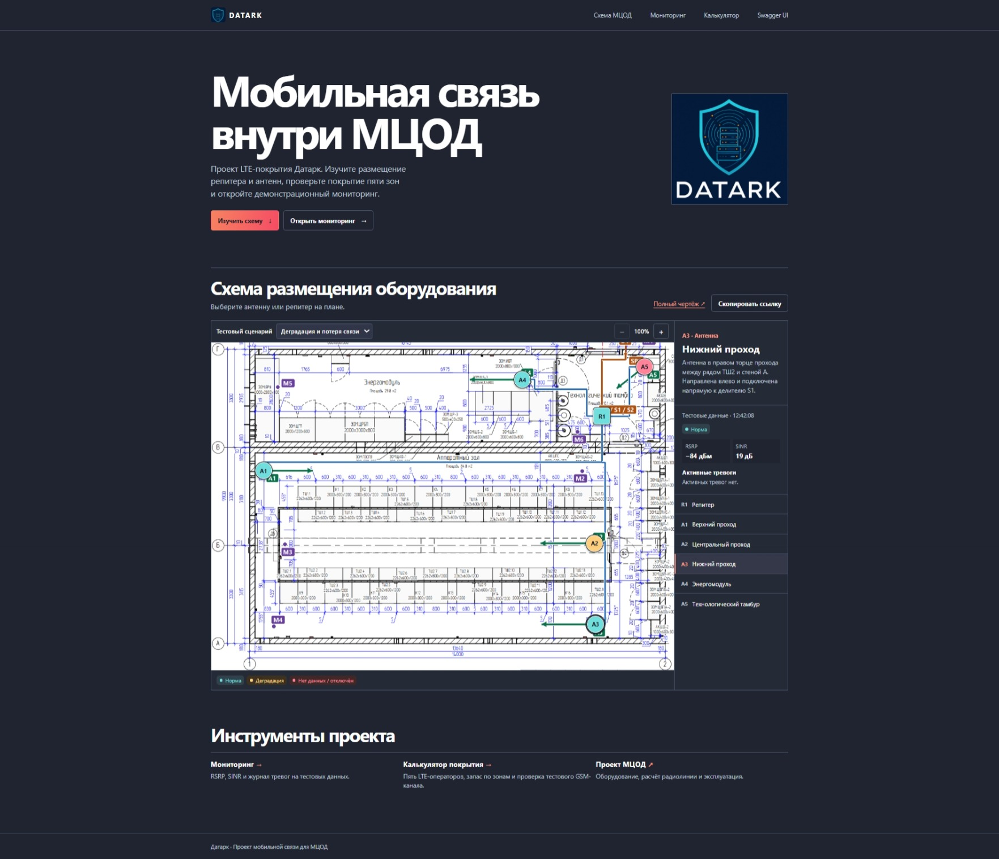
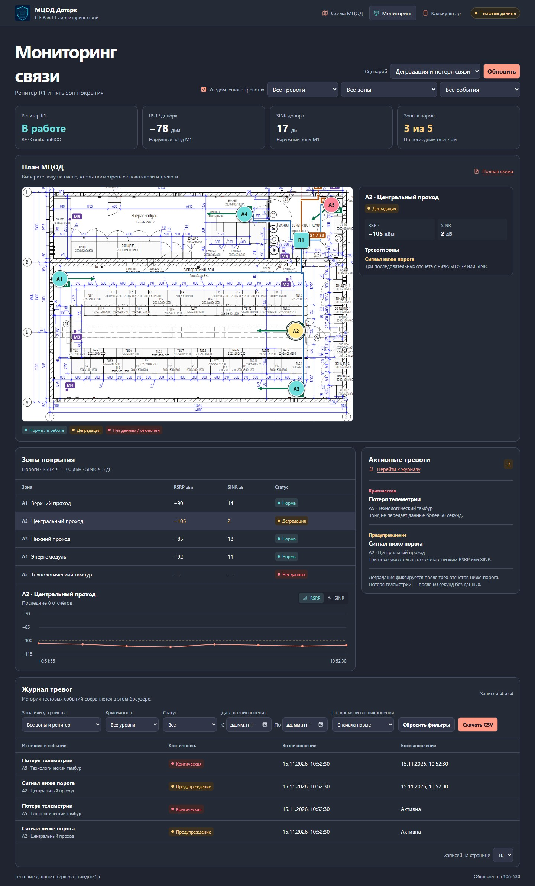
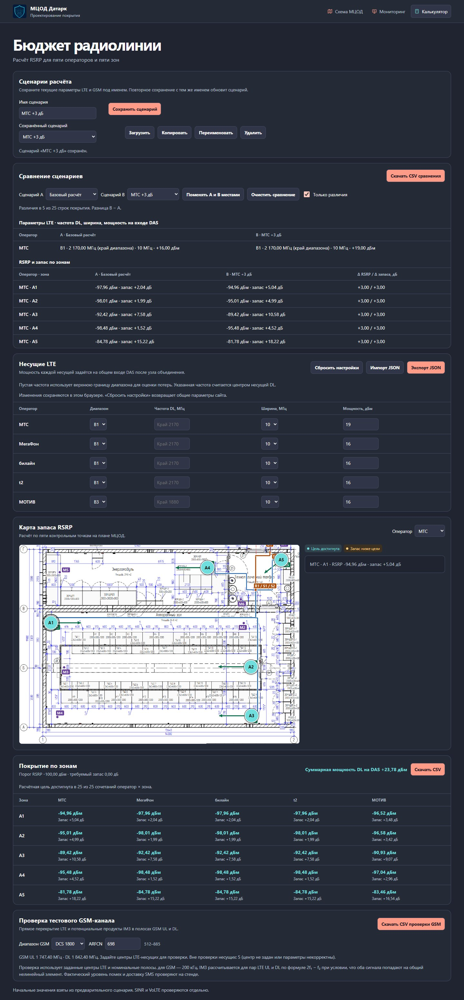

# MDPC-unirepeater

Проект мобильной связи для персонала модульного центра обработки данных (МЦОД). Решение рассчитано на пять операторов LTE и пять внутренних зон покрытия для VoLTE и передачи данных. Антенна Антэкс Nitsa-7 и GSM-модем TELEOFIS RX100‑R2 продолжают работать в составе штатного тракта аварийных SMS.

## Документация

- [Проект МЦОД](docs/mdpc-radio-project.md) — спецификация оборудования, бюджет радиолинии и инструкция по настройке и эксплуатации.
- [Уточнения после консультации с экспертами](docs/mdpc-radio-five-operators.md) — предварительный расчёт для пяти операторов, приёмка всех зон и программа испытаний аварийных SMS.
- [Программа испытаний аварийных SMS](docs/mdpc-radio-five-operators.md#проверка-аварийных-sms) — проверка доставки при выключенном и включённом LTE.
- [Расчёт бюджета внутренней радиолинии](docs/mdpc-link-budget.md) — формулы, DL/UL и запас по пяти зонам. [Таблица для пяти операторов](docs/mdpc-link-budget.csv).
- [План размещения оборудования](docs/mdpc-radio-layout.png) — точки установки наружного и внутреннего оборудования и кабельные трассы.

## Сайт проекта

[Открыть сайт Датарк на VPS](https://72.56.14.198/)

Скриншоты сайта и Swagger на VPS

**Главная и интерактивная схема МЦОД**

**Мониторинг связи и журнал тревог**

**Калькулятор бюджета радиолинии**

**Swagger UI на VPS**

Все семь запросов вернули `200 OK`.

[Открыть главную страницу на GitHub Pages](https://cricko7.github.io/MDPC-unirepeater/) с интерактивным планом МЦОД. Метки на схеме окрашены по статусу мониторинга. Выберите зону, чтобы увидеть RSRP, SINR и активные тревоги. Тестовый сценарий можно менять на главной и в мониторинге. Выбранные сценарий и зона сохраняются в браузере. Главная и мониторинг синхронизируют их между открытыми вкладками. Кнопка «Скопировать ссылку» создаёт ссылку, которая открывает выбранную точку и сценарий в другом браузере.

## Проверка API на VPS

Для проверки публичных запросов через [Swagger Editor](https://editor.swagger.io/) скачайте [спецификацию OpenAPI](docs/datark-public-openapi.json) и импортируйте её через **File → Import file**. Разверните `GET`, затем нажмите **Try it out → Execute**. В спецификацию входят состояние сервера, публичные стартовые настройки и тестовые результаты SMS.

Эти запросы можно выполнять на VPS без изменения настроек:

- `GET /healthz` возвращает состояние сервера и SHA развёрнутого коммита. Для работающего сервера ожидается `200 OK` и `"status": "ok"`.
- `GET /assets/site-defaults.json` возвращает публичные стартовые настройки.
- `GET /admin/settings` возвращает текущие настройки после входа.
- `GET /api/sms-test-results` показывает тестовые результаты доставки аварийных SMS и задержку при выключенном и включённом LTE.
- `GET /api/telemetry` возвращает тестовые статусы, RSRP, SINR, активные тревоги и восемь отсчётов для графика. Без параметров используется серверный сценарий. Параметр `scenario` принимает `mixed`, `normal` или `offline`.

В админ-панели раздел «Телеметрия зоны» показывает текущие данные выбранной зоны A1–A5. Там можно задать статус, RSRP, SINR и активные тревоги или нажать «Вернуть к симуляции». Ручные данные действуют во всех сценариях и сохраняются на сервере. Главная и мониторинг подхватывают изменение при следующем запросе. Через Swagger доступны те же действия по `PUT /admin/telemetry`. Для сброса через API отправьте `{"zone":"A3","override":null}`.

В [Swagger на VPS](https://72.56.14.198/admin/api/) после успешного PUT появится подтверждение и ссылка «Открыть мониторинг». Для телеметрии ссылка открывает изменённую зону, для общих настроек включает режим «По настройкам сайта». Открытые вкладки того же браузера сразу запрашивают свежую телеметрию.

`PUT /admin/settings` заменяет общие стартовые настройки. Для пробной записи используйте тестовый контейнер.

Кнопка «Вернуть все зоны к симуляции» сбрасывает ручные значения всех пяти зон после подтверждения. Через API для общего сброса отправьте `{"zone":"all","override":null}` на `PUT /admin/telemetry`.

Главная и мониторинг запрашивают тестовую телеметрию с VPS каждые пять секунд в активной вкладке. В режиме «По настройкам сайта» сервер сразу учитывает изменения общего сценария. Кнопка «Обновить» в мониторинге делает внеочередной запрос. На GitHub Pages работает локальная симуляция. Калькулятор обновляет параметры LTE и GSM, пока используются общие значения. Кнопка «Сбросить настройки» возвращает к ним после локальных правок.

## Прототип мониторинга

[Открыть прототип на GitHub Pages](https://cricko7.github.io/MDPC-unirepeater/monitor/)

[Калькулятор для пяти операторов](https://cricko7.github.io/MDPC-unirepeater/monitor/budget.html) пересчитывает RSRP и запас по пяти зонам при изменении диапазона, частоты, ширины или мощности несущей. Для локального запуска калькулятора выполните `python -m http.server` из корня репозитория и откройте `http://localhost:8000/monitor/budget.html`.

Кнопка «Скачать CSV» в калькуляторе выгружает 25 строк, по одной на пару «оператор × зона». Каждая строка содержит параметры несущей, RSRP и запас до порога. Для пустого поля частоты в CSV указывается верхняя граница, использованная в расчёте.

На 2D-карте калькулятора можно выбрать оператора и посмотреть расчётный запас в каждой из пяти зон. Проверка тестового GSM-канала по ARFCN показывает прямые перекрытия и возможные продукты IM3 от пар LTE-несущих с заданным центром. Уровень помех и доставку аварийных SMS подтверждают стендовые испытания.

Кнопка «Скачать CSV проверки GSM» выгружает параметры канала, прямые перекрытия и продукты IM3 с указанием направления GSM и границ полосы. Если пересечений нет или центры LTE ещё не заданы, CSV содержит строку с итогом и числом проверенных несущих.

Калькулятор сохраняет правки параметров LTE всех пяти операторов, диапазона GSM и ARFCN в браузере. На GitHub Pages кнопка «Сбросить настройки» возвращает встроенный сценарий LTE и тестовый канал DCS 1800 с ARFCN 698.

«Экспорт JSON» скачивает текущие настройки всех пяти LTE-несущих и GSM-канала. «Импорт JSON» загружает такой файл, пересчитывает результаты и сохраняет настройки в браузере. Файл с некорректными параметрами отклоняется целиком.

В разделе «Сценарии расчёта» можно сохранить несколько наборов LTE и GSM под разными именами и загрузить любой из них. Наборы хранятся в этом браузере, а изменения текущих параметров записываются в именованный сценарий только по кнопке «Сохранить сценарий». Повторное сохранение с тем же именем обновляет набор.

Выбранный сценарий можно переименовать или удалить. Для переименования нужно свободное имя. Удаление выполняется после подтверждения.

«Копировать» создаёт отдельный сценарий под свободным именем и загружает его в калькулятор. После изменения параметров нажмите «Сохранить сценарий», чтобы обновить копию.

В разделе «Сравнение сценариев» выберите два сохранённых набора. Калькулятор покажет настройки LTE, RSRP и запас по всем парам «оператор × зона», разницу B − A и результаты GSM-проверки каждого набора. Сравнение использует сохранённые параметры и оставляет текущие поля калькулятора без изменений.

Выбор A и B сохраняется в браузере, и сравнение восстанавливается при перезагрузке. Переименование обновляет имя в выбранной паре, а удаление очищает соответствующий выбор.

Кнопка «Поменять A и B местами» пересчитывает разницу B − A в таблице и CSV и сохраняет новый порядок после перезагрузки.

«Очистить сравнение» сбрасывает выбор A и B. После перезагрузки поля остаются пустыми, а сценарии доступны в списке.

«Скачать CSV сравнения» выгружает один файл с 25 строками покрытия и строками GSM-проверки для A и B. Столбец «Тип строки» различает эти записи. Для GSM сохраняется итог проверки, даже если пересечений нет.

Переключатель «Только различия» оставляет в сравнении и CSV строки с изменениями параметров LTE, RSRP или запаса. Чтобы увидеть и выгрузить результаты GSM-проверки, выключите переключатель.

Откройте [monitor/index.html](monitor/index.html) в браузере из локальной копии репозитория. Прототип показывает состояние репитера R1, RSRP и SINR наружного зонда и пяти зон покрытия, график выбранной зоны и активные тревоги. На интерактивном плане цвет меток показывает статус, а выбор зоны открывает её показатели и тревоги. Тестовые сценарии переключаются в интерфейсе. Данные обновляются каждые 15 секунд и по кнопке «Обновить».

Журнал и выбранный тестовый сценарий сохраняются в локальном хранилище браузера и восстанавливаются при перезагрузке страницы. Журнал можно отфильтровать по зоне или репитеру, критичности, статусу и дате возникновения. Даты «С» и «По» включены в период и определяются по местному времени браузера. Можно указать одну из дат.

В журнале можно выбрать 10, 25 или 50 записей на странице. Выбор сохраняется в браузере после перезагрузки. При изменении размера страницы, фильтров или сортировки открывается первая страница. CSV выгружает все записи по выбранным фильтрам и в выбранном порядке. Кнопка «Сбросить фильтры» возвращает полный журнал с выбранной сортировкой. Время в CSV указано в UTC. Для активных тревог поле восстановления пустое.

## Развёртывание на Linux

[Docker Compose, CI/CD и админ-панель](docs/deployment.md) для запуска отдельной серверной версии.
