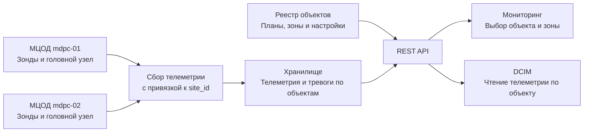

# Масштабирование на несколько МЦОД

Каждому МЦОД присваивается постоянный `site_id`, например `mdpc-01`. Зоны A1–A5 могут повторяться на разных объектах. Пара `(site_id, zone_id)` однозначно определяет зону. Текущий прототип обслуживает один МЦОД и отдаёт тестовые данные через `GET /api/telemetry`. Схема ниже описывает расширение для нескольких объектов.

| Данные | Как разделяются |
| --- | --- |
| План, зоны и настройки | По `site_id` хранятся план с метками, перечень зон и устройств, параметры пяти операторов и пороги. Изменения настроек применяются к выбранному объекту. |
| Зонды и головной узел | Устройство регистрируется за одним `site_id` с идентификатором `device_id`. При приёме показаний сервер сверяет объект с регистрацией устройства. |
| Измерения | Запись содержит `site_id`, `zone_id`, `operator_id`, `device_id`, время, RSRP и SINR. Состояние головного узла хранится по объекту и устройству. |
| Тревоги | Тревога привязана к объекту, источнику и типу события. Для операторских измерений учитывается `operator_id`. В журнале хранятся время возникновения и восстановления. |

Для подключения нового МЦОД заведите `site_id`, загрузите план с метками и зарегистрируйте оборудование. После обследования заполните параметры несущих и пороги, затем проверьте, что показания и тревоги видны у нужного объекта, в том числе при одинаковых номерах зон на разных площадках. Для просмотра нескольких МЦОД мониторинг получает список доступных объектов и загружает данные выбранного.

Для DCIM предлагается маршрут чтения `GET /api/sites/{site_id}/telemetry`. Он возвращает состояние головного узла, показания зон по операторам и активные тревоги выбранного МЦОД. Доступ выдаётся по списку объектов, разрешённых учётной записи DCIM, а настройки меняются через админ-панель с правами на конкретный объект. При развёртывании нескольких радиосистем дополнительно проверяют влияние соседних репитеров на общую базовую станцию.

[Текущий OpenAPI](datark-public-openapi.json) · [Пятиоператорная архитектура](mdpc-radio-five-operators.md#архитектура-и-оборудование)
